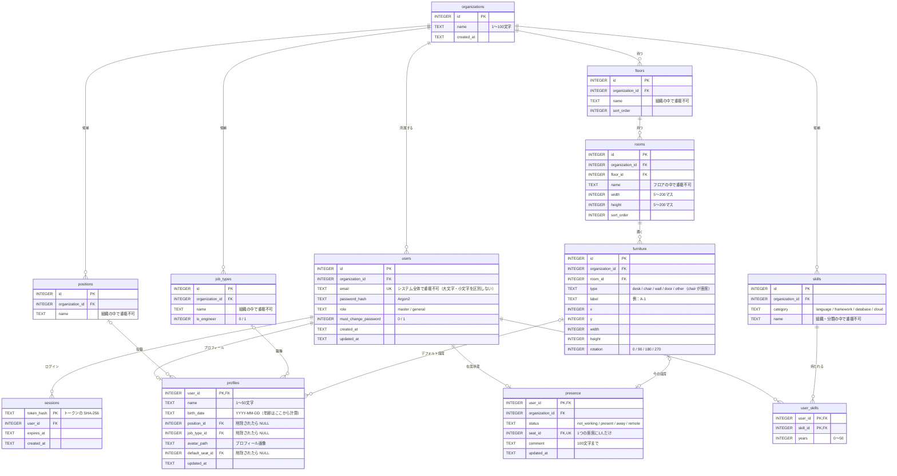

# 08. ER図

データベースのテーブルと、テーブルどうしの関係の図。マイグレーション `0002_drop_troubles.sql` まで適用した状態。
テーブルの説明は [04. DB設計](04-database.md)、実際の定義は API のリポジトリの `migrations/` を参照。

図は Mermaid で書いている。GitHub ではそのまま図として表示される。VS Code では Markdown のプレビュー（Ctrl + Shift + V）で表示できる（拡張機能「Markdown Preview Mermaid Support」が必要）。

## 全体

## 記号の読み方

| 記号 | 意味 |
|---|---|
| `\|\|--o{` | 1 対 0以上（例：1つの組織に、ユーザーが0人以上） |
| `\|\|--o\|` | 1 対 0か1（例：1人のユーザーに、プロフィールは0か1つ） |
| `\|o--o{` | 0か1 対 0以上（例：役職は、0人以上のプロフィールから選ばれる。プロフィール側は役職なしでもよい） |
| `\|o--o\|` | 0か1 対 0か1（例：1つの座席に、在席している人は0か1人） |
| PK / FK / UK | 主キー / 外部キー / 重複不可 |

## 図だけでは分からないルール

- **組織ごとの分離**：`organization_id` を持つテーブルは、必ず組織で絞り込んで読み書きする（図では、`organizations` から `rooms`・`furniture`・`presence` への線は省略している）
- **削除の連鎖**：組織を削除すると、その組織のデータはすべて削除される（`ON DELETE CASCADE`）。ユーザーを削除すると、セッション・プロフィール・スキル・在席状態も削除される
- **候補・座席の削除**：役職・職種・デフォルト座席が削除されたら、プロフィールの側は空（NULL）になる
- **在席状態と座席**：`present`（在席中）・`away`（離席中）のときだけ `seat_id` が入る（CHECK 制約）。`seat_id` は UNIQUE なので、同じ座席に2人は座れない
- **初回登録**：`profiles` の行があれば、プロフィールの初回登録が済んでいる
- **マスター**：マスターはプロフィールと在席状態を持たない（マップに表示しない）
